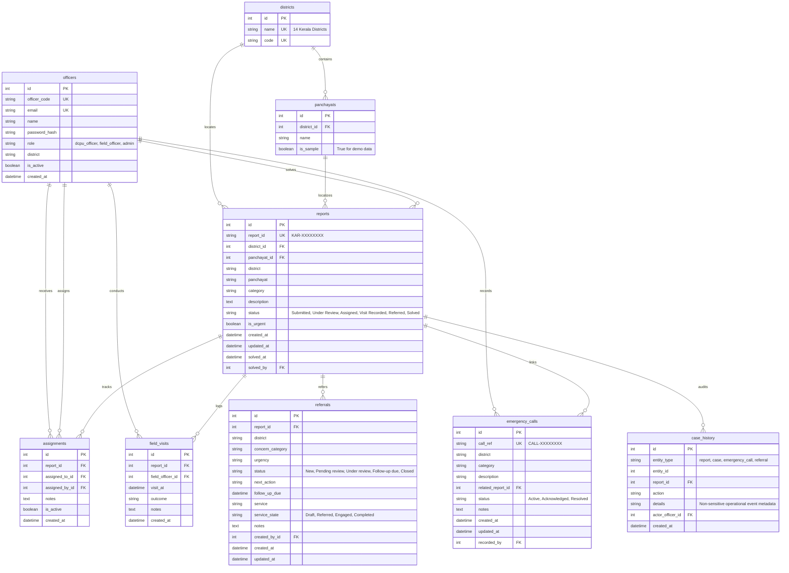

# Karuthal Database Schema Architecture

The Karuthal database utilizes SQLAlchemy 2.x with declarative models, strict foreign key constraints, automated UTC timestamps, and composite indexing tailored for fast querying by district and status.

---

## Mermaid Entity-Relationship Diagram

---

## Architectural Principles

1. **Unified Case Entity**: Reports and Cases share the same physical database table (`reports`). A case *is* a report row progressing through defined operational states.
2. **Zero Sensitive Audit**: `case_history` never records citizen descriptions, child names, contact numbers, or credentials. It references IDs and operational action labels only.
3. **Compound Query Indexes**:
   - `ix_reports_district_status`: accelerates real-time polling on `/api/dashboard`.
   - `ix_calls_district_status`: accelerates emergency alert queries.
   - `ix_panchayats_district_name`: validates district-panchayat integrity efficiently.
4. **PostgreSQL Compatibility**: SQLite is used for local development via WAL mode and foreign key pragmas; all data types and constraints cleanly migrate to PostgreSQL without schema modifications.
