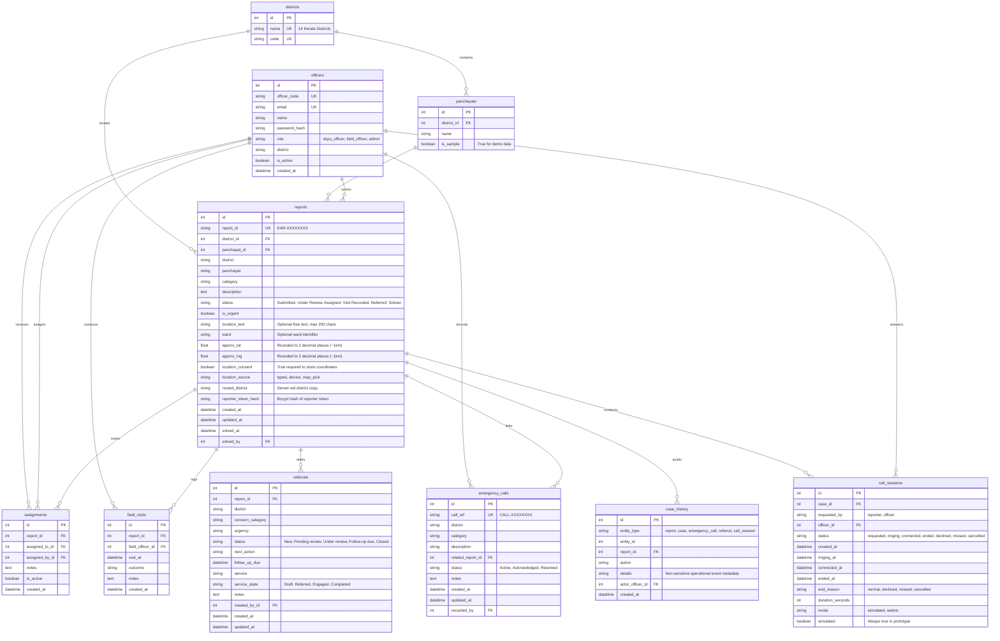

# Karuthal Database Schema Architecture

The Karuthal database utilizes SQLAlchemy 2.x with declarative models, strict foreign key constraints, automated UTC timestamps, and composite indexing tailored for fast querying by district and status.

---

## Mermaid Entity-Relationship Diagram

---

## Architectural Principles

1. **Unified Case Entity**: Reports and Cases share the same physical database table (`reports`). A case *is* a report row progressing through defined operational states.
2. **Zero Sensitive Audit**: `case_history` never records citizen descriptions, child names, contact numbers, or credentials. It references IDs and operational action labels only.
3. **Location Privacy & Retention**: Coordinates are rounded to 2 decimal places (~1 km precision) before storage and discarded if consent is false. Coordinates are subject to a retention period (`LOCATION_RETENTION_DAYS`, default 90 days) via `apply_location_retention_policy()`.
4. **Anonymous Reporter Token**: Reporters authenticate callbacks via `report_id` + `X-Reporter-Token`. Only the bcrypt hash (`reporter_token_hash`) is persisted; the plain token is returned once upon report submission and never logged.
5. **No Call Recording**: `call_sessions` records metadata only (timestamps, duration, participant role, end reason). Audio is neither transmitted to real telecom networks nor recorded/transcribed.
6. **Compound Query Indexes**:
   - `ix_reports_district_status`: accelerates real-time polling on `/api/dashboard`.
   - `ix_calls_district_status`: accelerates emergency alert queries.
   - `ix_call_sessions_case_status`: accelerates active call verification and history queries.
   - `ix_panchayats_district_name`: validates district-panchayat integrity efficiently.
7. **PostgreSQL Compatibility**: SQLite is used for local development via WAL mode and foreign key pragmas; all data types and constraints cleanly migrate to PostgreSQL without schema modifications.

---

## Limitations

- **Prototype Prototype Only**: Designed for academic demonstration of privacy-preserving case support workflows. Not cleared for production deployment or handling live cases.
- **Legal Compliance**: Operational use requires formal legal audits under the Juvenile Justice Act, Protection of Children from Sexual Offences (POCSO) Act, and the Digital Personal Data Protection (DPDP) Act 2023.
- **Telephony & Signalling**: Real-world voice callbacks require certified telecommunication infrastructure, secure STUN/TURN clusters, and legal consent mechanisms.
